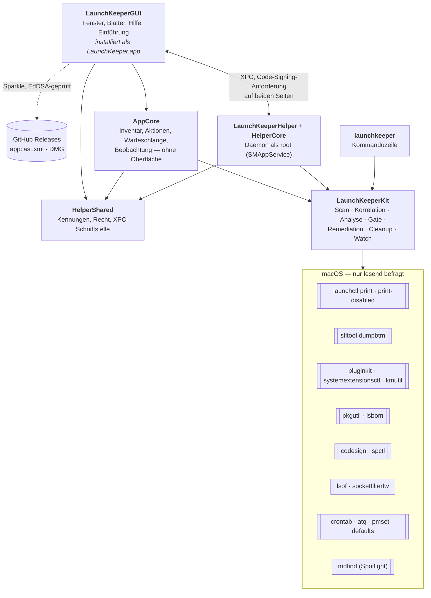
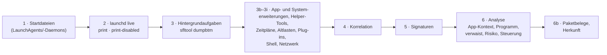
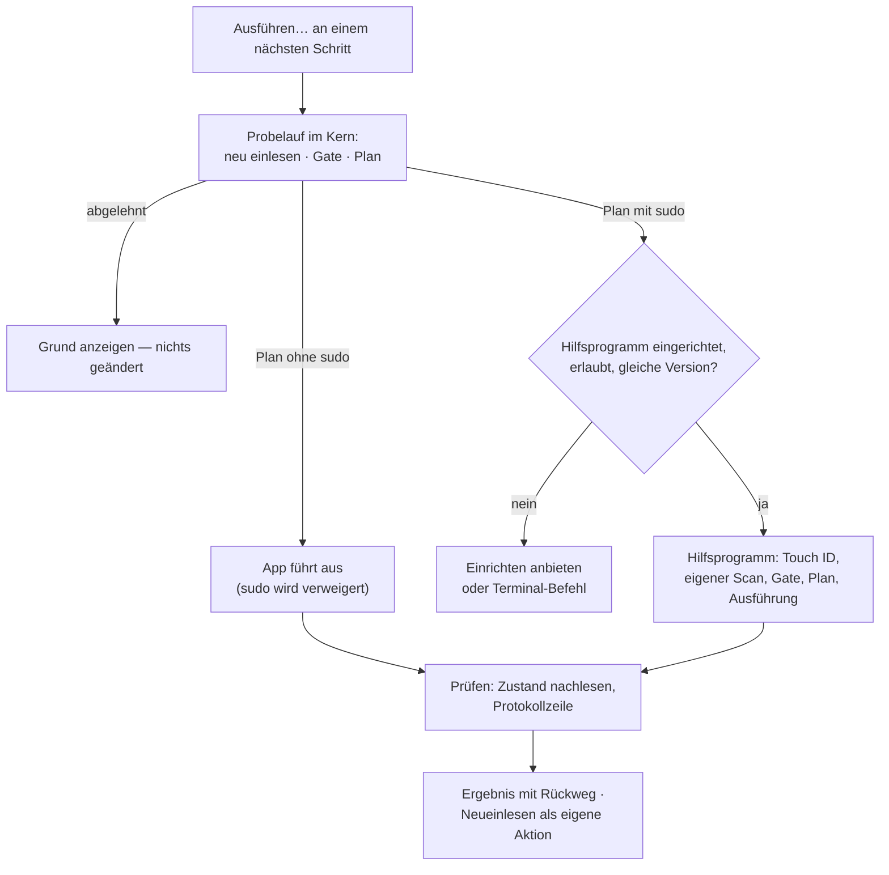
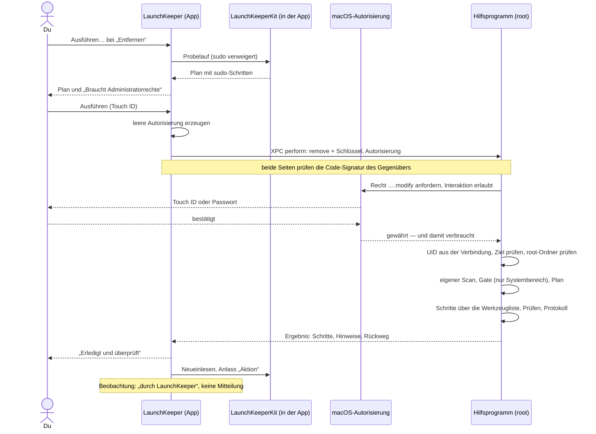
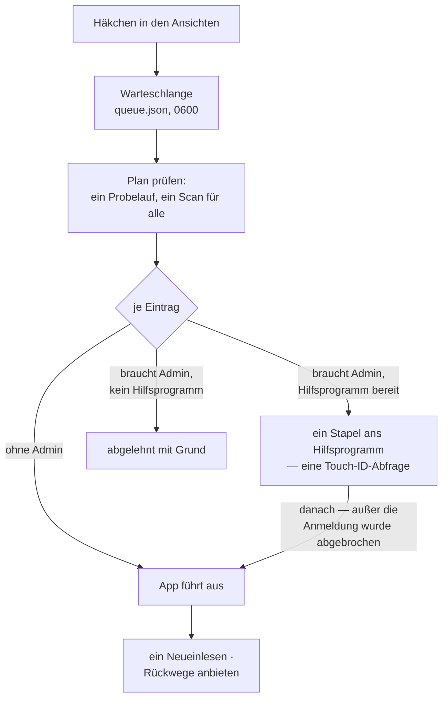
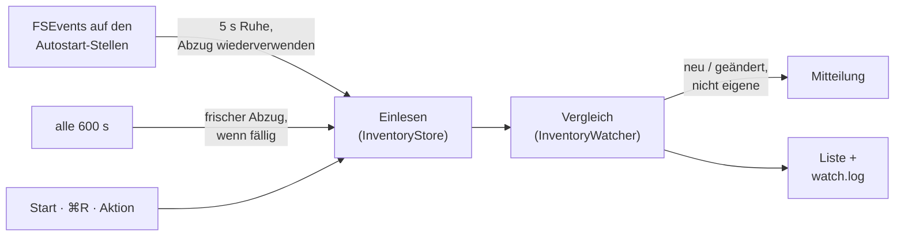
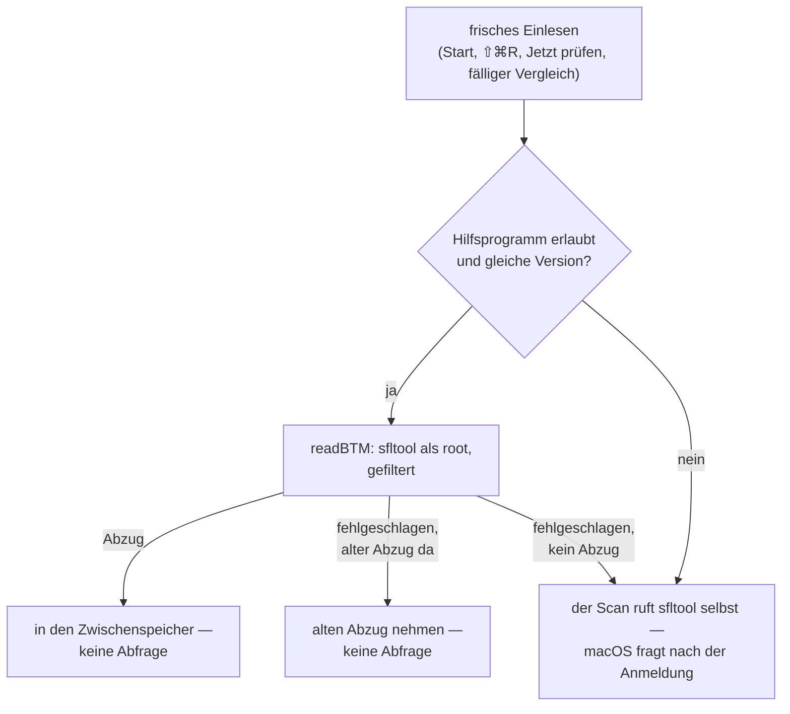

# Wie LaunchKeeper gebaut ist

Dieser Text erklärt, **was** LaunchKeeper tut, **wie** es das tut und **warum** es so gebaut ist.
Er richtet sich an alle, die mehr wissen wollen als die Bedienung hergibt. Die Gründe stehen
hier bei den Stellen, an denen sie wirken; die Geschichte dahinter im [CHANGELOG](../CHANGELOG.md).

Für die Bedienung gibt es das [Handbuch](handbuch/), für jede einzelne Funktion die
[Funktionsreferenz](funktionen.md), für das Werkzeug darunter das
[Handbuch der Kommandozeile](https://github.com/tietjen/launchkeeper#readme).

## Die fünf Leitsätze

Fast jede Eigenart von LaunchKeeper lässt sich auf einen dieser Sätze zurückführen.

1. **Ohne dein Zutun ändert sich nichts.** Das Einlesen ist nur lesend — nicht als Vorsatz,
   sondern weil die Scan-Pipeline des Kerns keinen schreibenden Code enthält; Schreiben lebt in
   eigenen Modulen. Die Beobachtung liest ebenfalls nur. Das Hilfsprogramm richtet LaunchKeeper
   nicht von selbst ein.
2. **Plan → Ausführen → Prüfen.** Jede Aktion rechnet zuerst einen Probelauf und zeigt ihn.
   Ausgeführt wird in einem zweiten, ausdrücklichen Schritt; danach liest der Kern nach, ob der
   Zustand stimmt, und schreibt eine Protokollzeile.
3. **Entfernen heißt Quarantäne — es gibt immer einen Rückweg.** Dateien werden verschoben (mit
   Manifest) oder vor dem Löschen gesichert. Deaktivieren lässt sich mit Aktivieren umkehren.
   Endgültig gelöscht wird nur im Terminal, mit `launchkeeper quarantine purge --apply`.
4. **Root nur über das Hilfsprogramm — und das nimmt nur „was mit welchem Eintrag“, nie
   Befehle.** Die App selbst führt keinen einzigen `sudo`-Schritt aus. Das Hilfsprogramm
   bekommt eine Operation und einen Namen, sucht den Eintrag selbst, plant selbst und fragt bei
   jeder Ausführung neu nach Touch ID oder Passwort.
5. **Dieselbe Prüfung wie die Kommandozeile; Apple und /System bleiben unangetastet.** App,
   Hilfsprogramm und `launchkeeper` benutzen denselben Kern mit demselben Gate. Es gibt keinen
   zweiten Codeweg um das Gate herum.

## Die Teile

| Teil | Aufgabe | Warum getrennt |
|---|---|---|
| **LaunchKeeperKit** | der Kern aus dem öffentlichen Repo [`launchkeeper`](https://github.com/tietjen/launchkeeper), eingebunden ab Version 0.12.2 | dieselben Regeln für App, Hilfsprogramm und Kommandozeile; Änderungen landen zuerst im Kern |
| **AppCore** | alles, was die App weiß und entscheidet, ohne SwiftUI: Inventar und Filter, Aktionen, Warteschlange, Beobachtung | mit XCTest prüfbar, ohne Fenster und ohne Hilfsprogramm |
| **LaunchKeeperGUI** | die SwiftUI-Oberfläche, Sparkle, Mitteilungen, Anmeldeobjekt | das Produkt heißt nicht „LaunchKeeper“: auf einem Dateisystem ohne Groß-/Kleinschreibung hätte es sich mit dem CLI-Ziel `launchkeeper` ein Build-Verzeichnis geteilt (CI, 2026-09-26). `build-app.sh` legt es als `Contents/MacOS/LaunchKeeper` ab. |
| **HelperShared** | was App und Hilfsprogramm gemeinsam festlegen müssen: Bundle-IDs, Team, Code-Signing-Anforderungen, das Autorisierungsrecht, die XPC-Schnittstelle, Anfrage- und Antworttypen | ein Modul ohne Abhängigkeiten — beide Seiten kompilieren genau dieselben Definitionen |
| **HelperCore** | die Logik des Hilfsprogramms: Ausführen mit den Engines des Kerns, Werkzeugliste, Vertrauensprüfung der Quarantäne | ohne Daemon testbar |
| **LaunchKeeperHelper** | der Daemon: XPC-Listener, Autorisierung, Leerlauf-Ende | so klein wie möglich |
| **launchkeeper** | die Kommandozeile auf demselben Kern | eigenes Repo, eigene Releases, eigener Homebrew-Weg |

## Einlesen

Ein Einlesen ist ein `ScanCoordinator`-Lauf des Kerns. Er läuft nie auf dem Haupt-Thread: er
startet `launchctl`, `sfltool`, `pluginkit`, `codesign` und mehr und braucht Sekunden, das
erste Abfragen der Hintergrundaufgaben (Background Task Management, kurz BTM) nach längerer
Ruhe sogar Minuten.

**Korrelation.** Ein Eintrag der Hintergrundaufgaben ist nicht dasselbe wie eine plist: Ein
BTM-Datensatz kann einen SMAppService-Dienst, einen launchd-Job und ein Anmeldeobjekt zugleich
umfassen. Der `ItemCorrelator` führt Startdateien, launchd-Zustand und BTM-Datensätze zu
Einträgen zusammen; jede Verknüpfung trägt eine Zuverlässigkeit, und alle Belege bleiben in den
Quellen des Eintrags — sichtbar im Expertenmodus unter *Quellen*.

**Analyse.** Danach bestimmt der Kern, zu welcher App ein Eintrag gehört, was er wirklich
startet (auch hinter `bash -c` oder `arch`), ob er verwaist ist, welche Prüfhinweise gelten, was
sich an ihm steuern lässt (Steuerungsmatrix: Stufe, Aktionen, Mechanismus, Grund) und woher er
kommt (Paketbeleg, App Store, Homebrew …). Die Detailspalte der App baut daraus nur Worte; sie
erfindet keine eigenen Urteile.

**Der stabile Schlüssel.** Die Kommandozeile nummeriert Einträge („01“, „02“ …). Diese Nummern
sind je Lauf positionsabhängig und zeigen nach dem nächsten Einlesen womöglich auf einen anderen
Eintrag. Die App benutzt sie deshalb nie: Auswahl, Warteschlange, Beobachtung und Anfragen an das
Hilfsprogramm hängen am **stabilen Schlüssel** des Eintrags.

**Unvollständig ist nicht leer.** Antwortet eine Quelle nicht, die Einträge beiträgt (etwa
`launchctl print` oder `sfltool dumpbtm`), meldet der Scan sie als unvollständige Schicht. Die App
zeigt das in der Statusleiste — und zieht daraus nie den Schluss, ein Eintrag sei verschwunden:
Die Beobachtung vergleicht solche Läufe nicht, und die Warteschlange hakt „Von Hand“-Einträge dann
nicht als „weg“ ab.

**Der Abzug** (die von `sfltool dumpbtm` gelesene Liste der Hintergrundaufgaben) wird für die
Sitzung im Speicher gehalten
(`BTMDumpCache`, nichts auf der Platte). ⌘R und Dateiereignisse der Beobachtung nehmen ihn wieder;
der Start der App, ⇧⌘R, „Jetzt prüfen“ und der fällige Vergleich der Beobachtung holen einen
frischen — woher, steht unter [Hintergrundaufgaben über das Hilfsprogramm](#hintergrundaufgaben-über-das-hilfsprogramm).

Ein Neueinlesen, das während eines laufenden Scans angefordert wird, geht nicht verloren, wenn es
von der Beobachtung oder einer Aktion kommt: Es wird vorgemerkt und läuft danach. Treffen mehrere
zusammen, gewinnt „Aktion“ — damit eine eigene Änderung nie als fremde gemeldet wird.

## Aktionen, die etwas verändern

**Der Plan** kommt aus denselben Engines wie der Probelauf der Kommandozeile
(`RemediationEngine`, `CleanupEngine`) — mit einem Runner, der `sudo` grundsätzlich verweigert
(`NoSudoRunner`). Er zeigt jeden Schritt in Worten und als Befehl; Schritte über `sudo` tragen ein
Schloss.

**Das Gate** ist eine Positivliste, die bei jedem Zweifel ablehnt („fail-closed“). Eine Regel je
Schalter (launchd, pluginkit, cron, Anmelde-Skript, Firewall, Quarantäne), keine fällt in eine
andere durch. Beispiele: Labels `com.apple.*` sind immer nur lesbar, auch für „Aktivieren“; alles,
was unter `/System` liegt, wird abgelehnt, auch mit Administratorrechten; Entfernen gilt bei
launchd-Einträgen nur für verwaiste — ein funktionierender Eintrag wird stattdessen deaktiviert
oder mit „In die Quarantäne verschieben“ (`remove --working`) erst deaktiviert und dann
weggelegt.

**Ausführen** ist ein zweiter, ausdrücklicher Klick. Ein Plan ohne `sudo` läuft in der App; ein
Plan mit `sudo` geht an das Hilfsprogramm — nie an eine Shell. Das Hilfsprogramm bekommt dabei
**nicht den Plan**, sondern nur die Operation und den Schlüssel; es rechnet mit demselben Kern
selbst, was zu tun ist. Der Plan im Blatt ist die Vorschau, die du vor Touch ID gesehen hast.
App-Reste gehen nie an das Hilfsprogramm: Die Prüfung „die App ist weg“ braucht die
LaunchServices des Benutzers, die ein Daemon nicht hat.

**Prüfen.** Nach der Ausführung liest der Kern nach, je nach Schalter: launchd zeigt den neuen
Zustand, `crontab -l` liest genau die geänderte Tabelle zurück, `pluginkit` zeigt die Wahl,
`socketfilterfw --listapps` die Regel. Stimmt das nicht, heißt das Ergebnis „Nicht vollständig“ —
auch wenn jeder Befehl mit 0 endete. Jede Aktion schreibt eine Zeile ins Protokoll
(`operations.log`), auch abgelehnte.

**Danach** liest die App das Inventar mit dem Anlass „Aktion“ neu ein; die Beobachtung führt die
Unterschiede als „durch LaunchKeeper“ und meldet sie nicht.

## Der privilegierte Weg

Das Hilfsprogramm ist ein launchd-Daemon im App-Bundle (`Contents/Library/LaunchDaemons`,
`BundleProgram` im Bundle), registriert über `SMAppService.daemon` und erreichbar über seinen
Mach-Dienst `de.paranoidsecurity.LaunchKeeper.Helper`. launchd startet es bei Bedarf; nach
**60 s** ohne Anfrage beendet es sich.

### Eintrag entfernen mit Touch ID

### Was den Weg absichert

| Schutz | Wie |
|---|---|
| **Nur die echte App** | Listener **und** jede Verbindung verlangen `anchor apple generic`, Kennung `de.paranoidsecurity.LaunchKeeper` und das Team `Y2LTPLFG6D`. Jeder andere Prozess wird abgewiesen, auch einer desselben Benutzers. |
| **Nur das echte Hilfsprogramm** | Die App verlangt dasselbe umgekehrt (Kennung `de.paranoidsecurity.LaunchKeeper.Helper`) und spricht nie mit einem Hilfsprogramm einer anderen Version (`0.2.0` ist in beide eingebaut). |
| **Ein eigenes Recht** | `de.paranoidsecurity.LaunchKeeper.modify`: Administrator, nicht geteilt, Zeitfenster 0, drei Versuche, eigener Dialogtext auf Deutsch und Englisch. Fehlt das Recht, legt das Hilfsprogramm es beim Start an; eine bestehende Regel lässt es bis auf den Dialogtext, wie sie ist — ein Administrator könnte sie verschärft haben. |
| **Die Abfrage am Ort der Tat** | Die App schickt eine **leere** Autorisierung; erst das Hilfsprogramm fordert das Recht mit erlaubter Interaktion an, direkt vor der Aktion. Eine Freigabe, die die App selbst einholt, wäre bei Zeitfenster 0 schon verbraucht, bevor das Hilfsprogramm sie prüft (live 2026-09-26). |
| **Keine Befehle** | Eine Anfrage ist `kind` (disable, enable, remove, remove-working, restore, purge, uninstall — `purge` schickt die App nie) plus `target` (Schlüssel, Quarantäne-Name oder Paket-ID). Leer, länger als 1 024 Byte, mit Steuerzeichen oder mit führendem „-“ wird abgelehnt, bevor eine Engine sie sieht. |
| **Wer fragt, sagt die Verbindung** | UID und Benutzerordner kommen aus der XPC-Verbindung und der Benutzerdatenbank, nie aus der Anfrage. root als Aufrufer wird abgelehnt. |
| **Eins nach dem anderen** | Aktionen laufen auf einer seriellen Warteschlange — zwei Aktionen, die um denselben launchd-Zustand konkurrieren, würden die Prüfung danach wertlos machen. |
| **Nur der Systembereich** | `systemScopeOnly`: Einträge eines Benutzers (Benutzer-Domäne, App-Erweiterungen, eine Datei im Benutzerordner) lehnt das Hilfsprogramm ab — die ändert die App ohne Administratorrechte. Startdateien entfernt und sichert es nur in `/Library/LaunchAgents` und `/Library/LaunchDaemons`. Ein Systemdienst, dessen **Programm** in einem Benutzerordner liegt, bleibt entfernbar: geschrieben wird dort nichts. |
| **Keine Wege durch Benutzerland** | Deinstallationen verschieben nichts aus `/Users/`, temporären Ordnern, `/Volumes/` oder `/opt/homebrew/` und nichts, auf dessen Weg ein Ordner liegt, der nicht root gehört oder für alle schreibbar ist. |
| **Eine Werkzeugliste** | Der Kern plant Administrator-Schritte als `/usr/bin/sudo <werkzeug> …`. Das Hilfsprogramm streicht `sudo` und führt nur `launchctl`, `rm`, `cp`, `mv`, `mkdir`, `defaults`, `pkgutil`, `cksum` und `socketfilterfw` an festen Pfaden aus — alles andere endet mit „not on the helper's tool list“. |
| **Ein Ordner, der root gehört** | siehe unten |
| **Protokoll** | `/Library/Logs/launchkeeper/operations.log`, root gehörend, für Administratoren lesbar |

### Der Ordner, der root gehört

Quarantäne, Sicherungen und Konfigurationskopien des Hilfsprogramms liegen unter
`/Library/Application Support/launchkeeper` — nie im Benutzerordner. Vor **jeder** Anfrage legt
das Hilfsprogramm fehlende Ordner an und prüft die ganze Kette ab `/`: echte Ordner, keine
symbolischen Links, Besitzer root, für Gruppe und andere nicht schreibbar. Stimmt etwas nicht,
lehnt es ab und nennt die Reparatur (`sudo chown -R root:wheel …` und `sudo chmod -R go-w …`).

Geschrieben wird dort nur als root — vom Hilfsprogramm oder über `sudo` von der Kommandozeile
(`quarantine restore/purge --apply`); die App und `launchkeeper` ohne sudo lesen nur (Liste,
Planung einer Wiederherstellung). Sonst wäre „gehört root“ kein Beweis mehr.

Bevor das Hilfsprogramm etwas daraus **wiederherstellt**, prüft es den Eintrag noch einmal
(`QuarantineTrust.verifyEntry`): Eintrag, Manifest und jeder Ordner auf dem Weg zu den Dateien
gehören root und sind keine Links; jede Datei geht genau von `eintrag/files/<ursprung>` an ihren
Ursprung zurück; Ursprünge sind saubere absolute Pfade, nie unter `/System`, nie im Benutzerordner
des Aufrufers und nie an Orten, die Benutzer ändern können; Kopien von Paketbelegen heißen genau
`receipt/<paket>.bom` bzw. `.plist`. Einträge **deiner** Quarantäne (von der Kommandozeile oder
älteren Versionen) legt es nie zurück; dafür nennt es den Terminal-Befehl.

## Die Warteschlange

**Ein Scan plant alle.** „Plan prüfen“ rechnet alle offenen Einträge in einem Probelauf: Alle
Deaktivieren/Aktivieren/Entfernen laufen als ein Stapel des Kerns (`runBatch`) gegen **einen**
Scan, Reste, Wiederherstellungen und Deinstallationen folgen einzeln. Ein Eintrag bekommt je
Stapel nur eine Aktion — für eine zweite wäre der gemeinsame Scan schon veraltet.

**Administrator-Stapel zuerst.** „Alle ausführen“ schickt alle Einträge mit
Administrator-Schritten in **einem** Aufruf an das Hilfsprogramm, solange du noch vor dem
Bildschirm sitzt; danach führt die App die übrigen aus. Das Hilfsprogramm fragt einmal, mit einem
Dialogtext, der die Anzahl nennt („LaunchKeeper möchte 17 Autostart-Einträge ändern.“) — und
lehnt einen Stapel ab, dessen Text die Anzahl verschweigt, damit der Dialog nichts verharmlost.
Höchstens 500 Einträge je Stapel. Innerhalb des Stapels laufen die Schalter-Aktionen wieder als
ein Kern-Stapel gegen einen Scan; Wiederherstellen und Deinstallieren folgen der Reihe nach, die
Vertrauensprüfung jeweils direkt davor. Jeder Eintrag behält sein Gate, seine Prüfung und seine
Protokollzeile; ein Fehler hält die anderen nicht an. Den Fortschritt meldet das Hilfsprogramm je
Eintrag über eine Rückverbindung an die App.

**Abbrechen heißt nichts tun.** Bricht jemand den Touch-ID-Dialog ab, kommen alle
Administrator-Einträge als „nicht autorisiert“ zurück — dann laufen auch die übrigen nicht.

**Anhalten** wirkt nach dem laufenden Eintrag, in der App und im Hilfsprogramm. Das Stopp-Signal
entsteht im Hilfsprogramm in dem Moment, in dem der Stapel ankommt; ein Anhalten während des
Touch-ID-Dialogs geht also nicht verloren, und ein Stapel, der schon vor dem Dialog angehalten
wurde, fragt gar nicht erst. Bricht die Verbindung ab (App beendet oder abgestürzt), hält das
Hilfsprogramm die Stapel dieser Verbindung an.

**Von Hand.** Was weder App noch Hilfsprogramm ändern dürfen (Schalter der
Hintergrundaufgaben, System- und Kernel-Erweiterungen, Profile,
Datenschutz-Freigaben, Netzwerkdienste), steht mit Anleitung und Link in die Systemeinstellungen
in der Warteschlange. Nach jedem Einlesen hakt sie ab, was erledigt ist: verschwunden — nur bei
vollständigem Scan — oder beim Einreihen an und jetzt aus. Netzwerkdienste hakt sie nie selbst ab.

**Rückwege** gibt es nur für Einträge, die in **dieser** Sitzung gelaufen sind: Ein Status, der
aus der Datei gelesen wurde, beweist nichts.

**Speichern.** Die Warteschlange liegt in
`~/Library/Application Support/de.paranoidsecurity.LaunchKeeper/queue.json` — sie listet, was mit
Administratorrechten laufen soll, und wird deshalb vom ersten Byte an nur für den Besitzer lesbar
angelegt (0600, atomar umbenannt; Ordner 0700). Gelesen wird Eintrag für Eintrag; was diese
Version nicht versteht, fällt allein weg, und die Datei wird vorher unverändert daneben gelegt.

## Die Beobachtung

Der Vergleich ist der `InventoryWatcher` der Kommandozeile (`launchkeeper watch`): stabile
Schlüssel, das letzte **vollständige** Inventar als Ausgangsstand, unvollständige Läufe werden nie
verglichen. Apples Einträge und reine Laufzustände bleiben außen vor. Was die App hinzufügt:
**Jedes** Einlesen der App läuft durch den Vergleich — Start, ⌘R, nach einer Aktion, die eigenen
Anlässe der Beobachtung —, es wird also nichts doppelt eingelesen.

**Auslöser.** Dateiereignisse auf den Autostart-Stellen (LaunchAgents/-Daemons,
PrivilegedHelperTools, StartupItems, SystemExtensions, `paths.d`, Programme-Ordner, loginwindow,
crontab, Shell-Startdateien) starten nach 5 s Ruhe ein Einlesen — Installationsprogramme schreiben
in Schüben. Alle 600 s folgt ein vollständiger Vergleich, der fängt, was Dateiereignisse
verpassen. Lässt sich FSEvents nicht starten, läuft der regelmäßige Vergleich trotzdem.

**Eigene Änderungen.** Ein Unterschied gilt als LaunchKeepers eigener, wenn der Lauf den Anlass
„Aktion“ hat, gerade eine Aktion läuft oder die letzte vor weniger als 30 s endete — ein Scan, der
vor der Aktion begann, kann nach ihr fertig werden. Eigene Änderungen werden mit Vermerk ins
Protokoll geschrieben und nie gemeldet; Entfernungen werden nur aufgelistet.

**Mitteilungen** sagen, was aus ihnen wurde, aber nur, was sich messen lässt: Erlaubnis, Übergabe,
Eintrag in der Mitteilungszentrale, Anzeige bei LaunchKeeper im Vordergrund, Klick. Ob ein Banner
erschien, lässt sich von außen nicht feststellen — ein Fokus oder die Bildschirmfreigabe
unterdrücken es still.

**Ohne Fenster.** Die Einstellung „Beobachtung“ wirkt über einen eigenen Beobachter der
Benutzereinstellungen, auch ohne offenes Fenster; solange sie an ist, steht ein Auge in der
Menüleiste. Start bei der Anmeldung läuft über `SMAppService.mainApp`, ohne Hilfs-App.

## Hintergrundaufgaben über das Hilfsprogramm

`sfltool dumpbtm` — die Quelle für Anmeldeobjekte und Hintergrunddienste — lässt macOS nach einer
Administrator-Anmeldung fragen, wenn ein Benutzer es aufruft. Bis 1.0.0 hieß das Touch ID bei
jedem frischen Einlesen. Seit Hilfsprogramm 0.2.0 gibt es dafür einen eigenen, nur lesenden Aufruf:

**Ohne Autorisierung, dafür gefiltert.** `readBTM` fragt nicht nach Touch ID. Im Gegenzug gibt
das Hilfsprogramm nur zurück, was der Aufrufer sehen darf (`BTMDumpFilter`): die Abschnitte der
UIDs unter 500 (das System) und den des Aufrufers — dessen UID aus der Verbindung kommt —, nie die
Anmeldeobjekte anderer Benutzer. Ein Abschnittskopf zählt nur direkt nach einer Trennlinie; eine
Zeile, die nur so aussieht, schließt bis zum nächsten echten Kopf alles aus. Die Folge ist
bewusst in Kauf genommen: Auf einem Mac mit mehreren Benutzern sieht auch ein Benutzer ohne
Administratorrechte die systemweiten Hintergrundobjekte ohne Dialog — die meisten davon sind in
`/Library` ohnehin lesbar.

**Eigene Warteschlange.** `readBTM` läuft nicht auf der Warteschlange der Aktionen: Ein kalter
Abzug (bis 150 s) hält keine Aktion auf und eine Aktion kein Einlesen. Die App wartet höchstens
200 s.

**Ohne Hilfsprogramm** liest die Beobachtung die Hintergrundaufgaben höchstens alle sechs Stunden
frisch; auch ein abgebrochener Dialog zählt als Versuch, sonst käme er alle zehn Minuten wieder.
Ist das Hilfsprogramm da, schlägt aber fehl, nimmt die App den alten Abzug, statt ersatzweise zu
fragen — sofern es in dieser Sitzung schon einen gibt; sonst fragt macOS. Danach wartet sie
ebenfalls sechs Stunden, damit ein kaputtes Hilfsprogramm die Beobachtung
nicht alle zehn Minuten minutenlang aufhält.

## Auslieferung

| Schritt | Wie |
|---|---|
| **Bauen** | `Scripts/build-app.sh` (mit `--universal` für Apple silicon + Intel — so bauen CI und Release): Hilfsprogramm unter `Contents/MacOS/LaunchKeeperHelper`, seine launchd-plist unter `Contents/Library/LaunchDaemons`; die Info.plist des Hilfsprogramms steckt im Binary (`__TEXT,__info_plist`). Signiert wird von innen nach außen, ohne `--deep`, mit Hardened Runtime und Zeitstempel. |
| **Sprachen** | Der String-Katalog `Localization/Localizable.xcstrings` (Schlüssel = deutscher Text) wird in `de.lproj`/`en.lproj` kompiliert; die CI bricht ab, solange einem Text die englische Übersetzung fehlt. |
| **Veröffentlichen** | Ein Tag `v<version>` startet `.github/workflows/release.yml`, das `Scripts/release.sh` ausführt: Vorprüfung (sauberer Stand, `VERSION` und CHANGELOG-Abschnitt passen, beide Handbuch-Links der App antworten, die verlinkten Kapitel liegen vor), universeller Build, App notarisieren und heften, DMG bauen, notarisieren und heften, Sparkle-Signatur, `appcast.xml`, `SHA256SUMS`, GitHub-Release. Notarisiert gilt nur, wenn Apples Statuszeile „Accepted“ sagt — der Exit-Code beweist es nicht. Ein manueller Probelauf baut und signiert, ohne zu veröffentlichen. |
| **Updates** | Sparkle liest `releases/latest/download/appcast.xml` und installiert nur DMGs mit gültiger EdDSA-Signatur gegen den öffentlichen Schlüssel in der Info.plist (`SUPublicEDKey`). Ohne Feed im Bundle (Entwicklerversion) startet Sparkle gar nicht. |
| **Hilfsprogramm nach dem Update** | Das Update ersetzt das ganze Bundle, das Hilfsprogramm eingeschlossen. Das laufende alte beendet sich nach 60 s Leerlauf; launchd startet beim nächsten Aufruf das neue. Bis dahin schickt die App ihm nichts und bietet „Hilfsprogramm neu starten“ an. |
| **Homebrew** | `brew install --cask tietjen/tap/launchkeeper-app`; die Kommandozeile kommt getrennt über `brew install tietjen/tap/launchkeeper`. |

Die App gehört nach `/Applications`: launchd startet das Hilfsprogramm aus dem Bundle heraus.

## Warum so

Die meisten Regeln oben sind nicht entworfen, sondern gefunden — in Live-Läufen und in Reviews.

| Regel | Anlass |
|---|---|
| **Root hält nichts im Benutzerordner** (0.3.0, Hilfsprogramm 0.1.8) | Vier unabhängige Reviews fanden, dass das Hilfsprogramm als root mit Pfaden unter `~/Library/Application Support/launchkeeper` arbeitete, die jeder Prozess des Benutzers ändern kann: Ein symbolischer Link lenkte ein `chown` auf einen Systemordner; eine Wiederherstellung legte zurück, wohin ein benutzereigenes Manifest zeigte; und zwischen Prüfen und Schreiben ließ sich ein geprüfter Ordner per `rename` austauschen, weil dafür Schreibrecht im Elternordner genügt. Vorhanden seit 0.1.0. Antwort: der Ordner, der root gehört, mit Kettenprüfung vor jeder Anfrage, in den nur root schreibt. |
| **Nur der Systembereich, keine Wege durch Benutzerland** (0.3.2, Hilfsprogramm 0.1.9, Kern 0.12.1) | Was einem Benutzer gehört, ändert die App ohne root; root hat dort nichts zu suchen. Deinstallationen, die Dateien aus benutzerschreibbaren Orten verschieben würden, sind dieselbe Wettlauf-Lücke in anderer Form. |
| **Leere Autorisierung, keine Schonfrist** (live 2026-09-26) | Eine Freigabe, die die App selbst eingeholt hatte, war bei Zeitfenster 0 verbraucht, bevor das Hilfsprogramm sie prüfte. Seitdem fragt das Hilfsprogramm — einmal, dort, wo die Aktion passiert. |
| **Das Hilfsprogramm beendet sich selbst** (seit 0.1.1) | Ältere Hilfsprogramme liefen weiter und antworteten nach einem Update mit altem Code. Leerlauf-Ende plus Versionsvergleich sorgen dafür, dass nie zwei Versionen miteinander reden. |
| **Eine Autorisierung je Aufruf** (Review 2026-09-27) | Eine gemeinsame Liste, die nach jedem Aufruf geleert wurde, ließ eine einzelne Aktion während eines Warteschlangen-Laufs die Autorisierung des Laufs zerstören. |
| **Touch ID einmal je Lauf, Abbrechen heißt nichts tun** (TJ und Review 2026-09-27) | Ein Lauf mit 17 Einträgen sollte nicht 17-mal fragen — aber der Dialog muss sagen, worum es geht, und ein Abbrechen darf nicht stillschweigend den Rest laufen lassen. |
| **Hintergrundaufgaben über das Hilfsprogramm** (1.0.0) | Touch ID bei jedem frischen Einlesen war „zu häufig“. Die Vertrauensentscheidung (systemweite und eigene Abschnitte, ohne Autorisierung) steht im CHANGELOG unter „Security“. |
| **Unvollständig heißt nicht weg** (Beobachtung, Warteschlange) | Ein Scan, bei dem `sfltool` ins Zeitlimit lief, fehlen ganze Schichten. Ein Vergleich damit würde Dutzende Einträge als „entfernt“ melden. |
| **Netzwerkdienste hakt der Mensch ab** (0.3.3) | Ein Dienst steht nur im Inventar, solange sein Programm läuft; sein Verschwinden kann einfach „beendet“ heißen. |
| **Die Warteschlange überlebt einen Rückschritt** (0.3.3) | Ältere Versionen leerten die ganze Warteschlange, wenn sie einen Eintrag nicht lesen konnten. Seitdem: eintragsweise lesen, Original daneben legen, im Zweifel gar nicht speichern. |
| **Stabile Schlüssel statt Nummern** | Positionsnummern zeigen nach einem Scan mit anderer Zusammensetzung auf andere Einträge — der Kern hatte das in V0.4.3 gelernt, als ein Scan ohne BTM-Schicht anders nummerierte. |
| **Ein Hauptfenster** (1.1.0) | Inventar, Warteschlange und Einführung gibt es einmal; ein zweites Fenster verdoppelte sie nur. |
| **Hilfe im Code, nicht als Help Book** (1.1.0) | Sie wird über denselben String-Katalog übersetzt wie die Oberfläche; Hilfe und Bedienung können im Wortlaut nicht auseinanderlaufen, und es braucht keinen Hilfe-Indexer. |
| **Einführung als Popover an den echten Ansichten** (1.1.0/1.1.1) | Die Spalten des Fensters werden getrennt gehostet; eine gezeichnete Überlagerung bekäme ihre Lage nicht mit. Wo eine Karte nicht erscheinen kann, kommt nach einer Sekunde ein Blatt. |
| **Kein Release mit totem Handbuch-Link** | Hilfe-Fenster und Hilfe-Menü verlinken dieses Handbuch auf GitHub; `release.sh` liest die Adresse aus dem Quelltext und bricht ab, wenn sie nicht antwortet. |

## Wo was liegt

### Im Quelltext

| Pfad | Inhalt |
|---|---|
| `Sources/App` | die SwiftUI-App: Fenster, Ansichten, Detailspalte, Plan-Blatt, Warteschlange, Beobachtung, Einstellungen, Hilfe, Einführung, Sparkle, XPC-Client |
| `Sources/AppCore` | Inventar, Zusammenfassungen und nächste Schritte, Aktionen, Warteschlange, Beobachtung, „Von Hand“-Anleitungen |
| `Sources/HelperShared` | Kennungen, Code-Signing-Anforderungen, Recht, XPC-Protokolle, Anfrage- und Antworttypen |
| `Sources/HelperCore` | `PrivilegedExecutor`, `RootRunner` (Werkzeugliste), `QuarantineTrust` |
| `Sources/Helper` | der Daemon (`main.swift`) und seine Info.plist |
| `Localization/Localizable.xcstrings` | alle Texte, Deutsch und Englisch |
| `Scripts/` | `build-app.sh`, `release.sh`, `localize.sh` |

### Auf dem Mac

| Pfad | Inhalt | Wer schreibt |
|---|---|---|
| `~/Library/Application Support/de.paranoidsecurity.LaunchKeeper/queue.json` | die Warteschlange | App |
| `~/Library/Application Support/launchkeeper/quarantine` | deine Quarantäne — dieselbe wie die der Kommandozeile | App, Kommandozeile |
| `~/Library/Application Support/launchkeeper/backups`, `config-snapshots` | Sicherungen deiner eigenen Einträge | App, Kommandozeile |
| `~/Library/Logs/launchkeeper/operations.log` | Protokoll der Aktionen ohne Administratorrechte | App, Kommandozeile |
| `~/Library/Logs/launchkeeper/watch.log` | Ereignisse der Beobachtung (JSON-Zeilen) | App, `launchkeeper watch` |
| `/Library/Application Support/launchkeeper/{quarantine,backups,config-snapshots}` | Quarantäne, Sicherungen, Konfigurationskopien des Hilfsprogramms | nur root: das Hilfsprogramm, die Kommandozeile über `sudo` (`quarantine restore/purge --apply`) |
| `/Library/Logs/launchkeeper/operations.log` | Protokoll der Aktionen mit Administratorrechten | nur das Hilfsprogramm (root) |
| `LaunchKeeper.app/Contents/Library/LaunchDaemons/de.paranoidsecurity.LaunchKeeper.Helper.plist` | die launchd-Beschreibung des Hilfsprogramms | Build |
