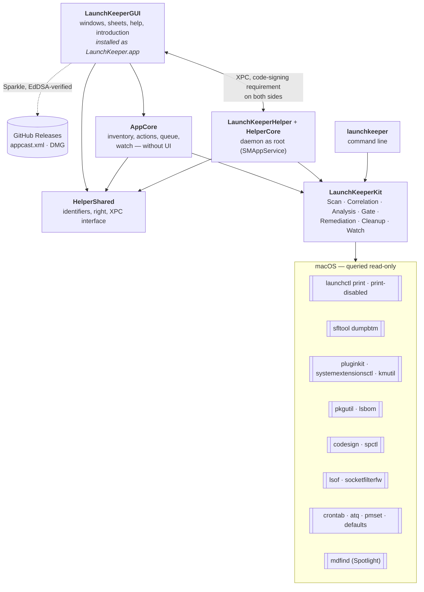
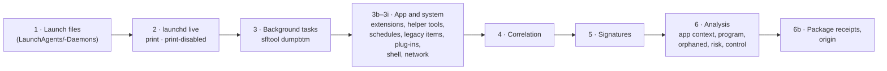
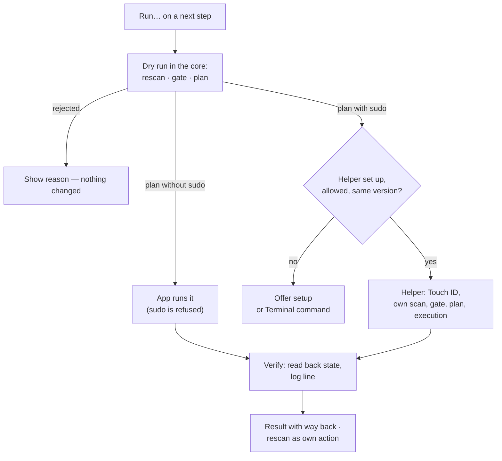
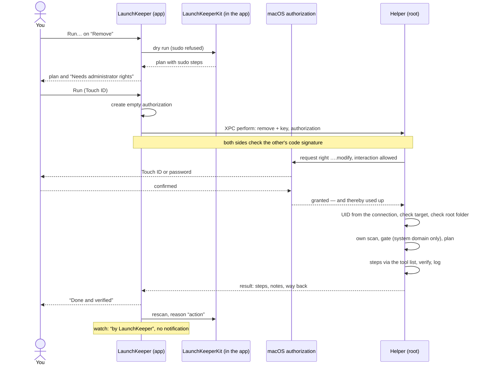
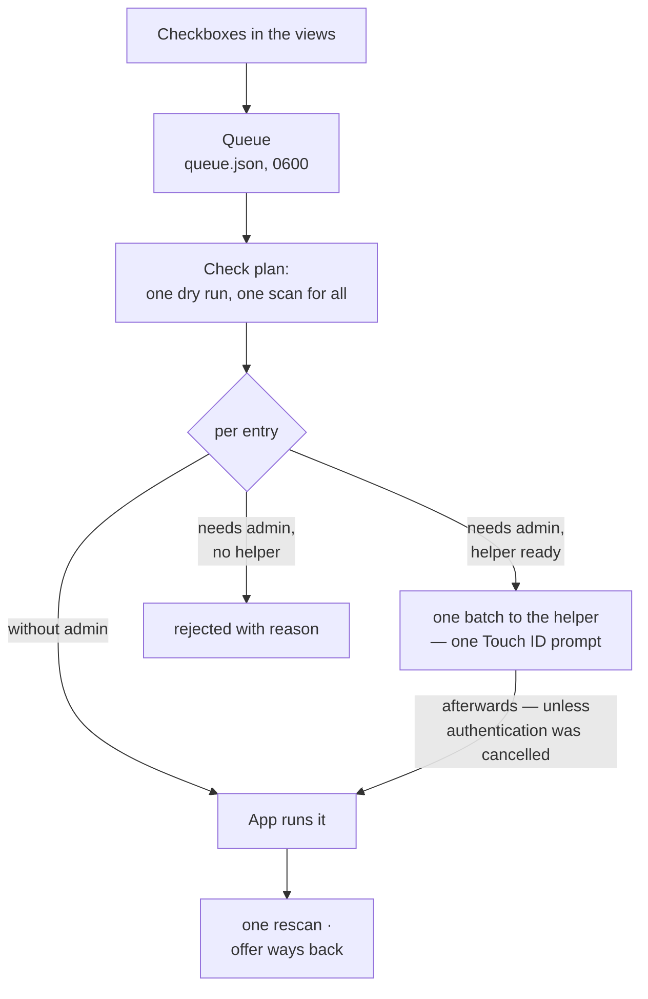
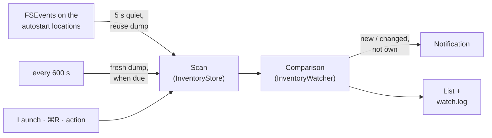
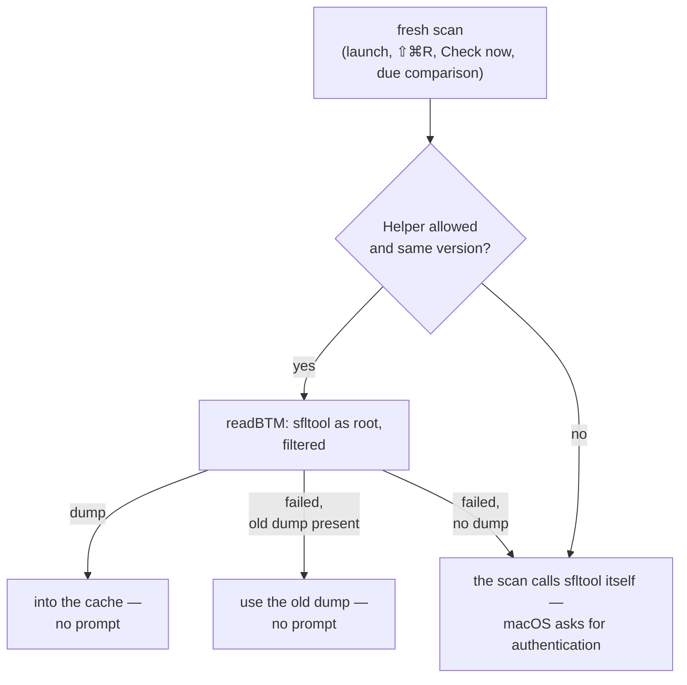

# How LaunchKeeper is built

*Deutsch: [Wie LaunchKeeper gebaut ist](../architektur.md)*

This text explains **what** LaunchKeeper does, **how** it does it and **why** it is built that
way. It is for everyone who wants to know more than using the app reveals. The reasons are given
here at the places where they take effect; the history behind them is in the
[CHANGELOG](../../CHANGELOG.md).

For using the app there is the [manual](manual/), for every single feature the
[feature reference](features.md), for the tool underneath the
[command-line manual](https://github.com/tietjen/launchkeeper#readme).

## The five principles

Almost every quirk of LaunchKeeper can be traced back to one of these statements.

1. **Nothing changes without your doing.** Scanning is read-only — not as an intention, but
   because the core's scan pipeline contains no writing code; writing lives in separate modules.
   The watch only reads as well. LaunchKeeper does not set up the helper by itself.
2. **Plan → run → verify.** Every action first computes a dry run and shows it. Execution happens
   in a second, explicit step; afterwards the core reads back whether the state is right, and
   writes a log line.
3. **Removing means quarantine — there is always a way back.** Files are moved (with a manifest)
   or backed up before they are deleted. Disable can be reversed with Enable. Deleting for good
   happens only explicitly, one quarantine entry at a time: in the Quarantine view with
   “Delete for good…” or in the Terminal with `launchkeeper quarantine purge --apply`.
4. **Root only through the helper — and it accepts only “what to do with which entry”, never
   commands.** The app itself does not run a single `sudo` step. The helper receives an
   operation and a name, looks up the entry itself, plans itself and asks for Touch ID or the
   password anew on every execution.
5. **The same check as the command line; Apple and /System stay untouched.** The app, the helper
   and `launchkeeper` use the same core with the same gate. There is no second code path around
   the gate.

## The parts

| Part | Job | Why separate |
|---|---|---|
| **LaunchKeeperKit** | the core from the public repo [`launchkeeper`](https://github.com/tietjen/launchkeeper), included from version 0.12.2 | the same rules for the app, the helper and the command line; changes land in the core first |
| **AppCore** | everything the app knows and decides, without SwiftUI: inventory and filters, actions, queue, watch | testable with XCTest, without a window and without the helper |
| **LaunchKeeperGUI** | the SwiftUI interface, Sparkle, notifications, login item | the product is not named “LaunchKeeper”: on a case-insensitive file system it would have shared a build directory with the CLI target `launchkeeper` (CI, 2026-09-26). `build-app.sh` places it as `Contents/MacOS/LaunchKeeper`. |
| **HelperShared** | what the app and the helper must define together: bundle IDs, team, code-signing requirements, the authorization right, the XPC interface, request and response types | a module without dependencies — both sides compile exactly the same definitions |
| **HelperCore** | the helper's logic: running with the core's engines, tool list, trust check of the quarantine | testable without the daemon |
| **LaunchKeeperHelper** | the daemon: XPC listener, authorization, idle exit | as small as possible |
| **launchkeeper** | the command line on the same core | its own repo, its own releases, its own Homebrew path |

## Scanning

A scan is a `ScanCoordinator` run of the core. It never runs on the main thread: it starts
`launchctl`, `sfltool`, `pluginkit`, `codesign` and more and takes seconds — the first query of
the background tasks (Background Task Management, BTM for short) after a longer idle period even
minutes.

**Correlation.** An entry in the background tasks is not the same as a plist: one BTM record can
cover an SMAppService service, a launchd job and a login item at once. The `ItemCorrelator`
merges launch files, launchd state and BTM records into entries; every link carries a
confidence, and all evidence stays in the entry's sources — visible in Expert mode under
*Sources*.

**Analysis.** Next, the core determines which app an entry belongs to, what it really starts
(even behind `bash -c` or `arch`), whether it is orphaned, which check hints apply, what can be
controlled about it (control matrix: level, actions, mechanism, reason) and where it comes from
(package receipt, App Store, Homebrew …). The app's detail column only builds words from this; it
does not make up verdicts of its own.

**The stable key.** The command line numbers entries (“01”, “02” …). These numbers depend on
position per run and may point to a different entry after the next scan. That is why the app
never uses them: selection, queue, watch and requests to the helper are tied to the entry's
**stable key**.

**Incomplete is not empty.** If a source that contributes entries does not answer (for example
`launchctl print` or `sfltool dumpbtm`), the scan reports it as an incomplete layer. The app shows
this in the status bar — and never concludes from it that an entry has disappeared: the watch does
not compare such runs, and the queue does not check off “By hand” entries as “gone” then.

**The dump** (the list of background tasks as read by `sfltool dumpbtm`) is kept in memory for
the session (`BTMDumpCache`, nothing on disk). ⌘R and the watch's file events reuse it; the app's
launch, ⇧⌘R, **Check now** and the watch's due comparison get a fresh one — where from is
described under [Background tasks through the helper](#background-tasks-through-the-helper).

A rescan requested while a scan is running is not lost if it comes from the watch or an action:
it is queued and runs afterwards. If several coincide, “action” wins — so that an own change is
never reported as someone else's.

## Actions that change something

**The plan** comes from the same engines as the command line's dry run
(`RemediationEngine`, `CleanupEngine`) — with a runner that refuses `sudo` on principle
(`NoSudoRunner`). It shows every step in words and as a command; steps via `sudo` carry a lock.

**The gate** is an allowlist that rejects whenever in doubt (“fail-closed”). One rule per switch
(launchd, pluginkit, cron, login script, firewall, quarantine); none falls through into another.
Examples: `com.apple.*` labels are always read-only, even for “Enable”; anything under `/System`
is rejected, even with administrator rights; for launchd entries, Remove applies only to orphaned
ones — a working entry is disabled instead, or, with **Move into quarantine**
(`remove --working`), first disabled and then put away.

**Run** is a second, explicit click. A plan without `sudo` runs in the app; a plan with `sudo`
goes to the helper — never to a shell. The helper does **not receive the plan**, only the
operation and the key; it computes what to do itself, with the same core. The plan in the sheet
is the preview you saw before Touch ID. App leftovers never go to the helper: the “the app is
gone” check needs the user's LaunchServices, which a daemon does not have.

**Verify.** After execution, the core reads back, depending on the switch: launchd shows the new
state, `crontab -l` reads back exactly the changed table, `pluginkit` shows the choice,
`socketfilterfw --listapps` the rule. If that does not match, the result reads “Incomplete” — even
if every command exited with 0. Every action writes a line to the log (`operations.log`), rejected
ones too.

**Afterwards** the app rescans the inventory with the reason “action”; the watch lists the
differences as “by LaunchKeeper” and does not report them.

## The privileged path

The helper is a launchd daemon in the app bundle (`Contents/Library/LaunchDaemons`,
`BundleProgram` in the bundle), registered via `SMAppService.daemon` and reachable through its
Mach service `de.paranoidsecurity.LaunchKeeper.Helper`. launchd starts it on demand; after
**60 s** without a request it quits.

### Removing an entry with Touch ID

### What secures the path

| Protection | How |
|---|---|
| **Only the real app** | The listener **and** every connection require `anchor apple generic`, identifier `de.paranoidsecurity.LaunchKeeper` and the team `Y2LTPLFG6D`. Every other process is rejected, even one of the same user. |
| **Only the real helper** | The app requires the same in reverse (identifier `de.paranoidsecurity.LaunchKeeper.Helper`) and never talks to a helper of a different version (`0.2.0` is built into both). |
| **A right of its own** | `de.paranoidsecurity.LaunchKeeper.modify`: administrator, not shared, timeout 0, three attempts, its own dialog text in German and English. If the right is missing, the helper creates it at launch; an existing rule it leaves as it is, apart from the dialog text — an administrator might have tightened it. |
| **The prompt where the action happens** | The app sends an **empty** authorization; only the helper requests the right with interaction allowed, right before the action. A grant the app obtained itself would already be used up at timeout 0 before the helper checks it (live 2026-09-26). |
| **No commands** | A request is `kind` (disable, enable, remove, remove-working, restore, purge, uninstall — the app sends `purge` only for entries of the helper's quarantine, since 1.2) plus `target` (key, quarantine name or package ID). Empty, longer than 1,024 bytes, with control characters or with a leading “-” is rejected before any engine sees it. |
| **The connection says who is asking** | UID and home folder come from the XPC connection and the user database, never from the request. root as the caller is rejected. |
| **One at a time** | Actions run on a serial queue — two actions competing for the same launchd state would make the verification afterwards worthless. |
| **System domain only** | `systemScopeOnly`: the helper rejects a user's entries (user domain, app extensions, a file in the home folder) — the app changes those without administrator rights. It removes and backs up launch files only in `/Library/LaunchAgents` and `/Library/LaunchDaemons`. A system service whose **program** lives in a home folder stays removable: nothing is written there. |
| **No paths through user land** | Uninstalls move nothing from `/Users/`, temporary folders, `/Volumes/` or `/opt/homebrew/`, and nothing with a folder on its path that does not belong to root or is writable by everyone. |
| **A tool list** | The core plans administrator steps as `/usr/bin/sudo <tool> …`. The helper strips `sudo` and runs only `launchctl`, `rm`, `cp`, `mv`, `mkdir`, `defaults`, `pkgutil`, `cksum` and `socketfilterfw` at fixed paths — anything else ends with “not on the helper's tool list”. |
| **A folder owned by root** | see below |
| **Log** | `/Library/Logs/launchkeeper/operations.log`, owned by root, readable by administrators |

### The folder owned by root

The helper's quarantine, backups and configuration copies live under
`/Library/Application Support/launchkeeper` — never in the home folder. Before **every** request
the helper creates missing folders and checks the whole chain from `/`: real folders, no symbolic
links, owner root, not writable by group and others. If something is wrong, it refuses and names
the fix (`sudo chown -R root:wheel …` and `sudo chmod -R go-w …`).

Only root writes there — the helper, or the command line via `sudo`
(`quarantine restore/purge --apply`); the app and `launchkeeper` without sudo only read (list,
planning a restore or a deletion). Otherwise “owned by root” would no longer prove anything.

Before the helper **restores** anything from it, it checks the entry once more
(`QuarantineTrust.verifyEntry`): the entry, the manifest and every folder on the way to the files
belong to root and are not links; every file goes back exactly from `entry/files/<origin>` to its
origin; origins are clean absolute paths, never under `/System`, never in the caller's home folder
and never in places users can change; copies of package receipts are named exactly
`receipt/<package>.bom` or `.plist`. Entries of **your** quarantine (from the command line or
older versions) it never puts back; for those it names the Terminal command.

The same holds for **deleting for good** (since 1.2): the helper deletes only entries of its own
quarantine, after checking that the entry belongs to root and was writable for nobody else
— with Touch ID on every execution. An entry of **your** quarantine that is yours through and
through (every folder in it owned by you and writable for you, no locked files) the app deletes
itself without administrator rights; the core plans `rm` for it without `sudo` (LaunchKeeperKit
0.13). If it contains files or folders you may not delete
(owned by root or locked), the app shows the plan and names the Terminal
command.

## The queue

**One scan plans everything.** **Check plan** computes all open entries in one dry run: all
Disable/Enable/Remove run as one batch of the core (`runBatch`) against **one** scan; leftovers,
restores and uninstalls follow one by one. An entry gets only one action per batch — for a second
one, the shared scan would already be stale.

**Administrator batch first.** **Run all** sends all entries with administrator steps to the
helper in **one** call, while you are still sitting at the screen; after that, the app runs the
rest. The helper asks once, with a dialog text that states the number (“LaunchKeeper wants to
change 17 startup items.”) — and rejects a batch whose text hides the number, so that the dialog
does not play anything down. At most 500 entries per batch. Within the batch, the switch actions
again run as one core batch against one scan; restores and uninstalls follow in order, each with
the trust check right before it. Every entry keeps its gate, its verification and its log line;
one failure does not stop the others. The helper reports progress per entry over a callback
connection to the app.

**Cancelling means doing nothing.** If someone cancels the Touch ID dialog, all administrator
entries come back as “not authorized” — then the rest do not run either.

**Stop** takes effect after the current entry, in the app and in the helper. The stop signal is
created in the helper the moment the batch arrives; so a stop during the Touch ID dialog is not
lost, and a batch that was stopped before the dialog does not even ask. If the connection breaks
(app quit or crashed), the helper stops that connection's batches.

**By hand.** What neither the app nor the helper may change (background task switches, system and
kernel extensions, profiles, privacy permissions, network services) is placed in the queue with
instructions and a link into System Settings. After every scan it checks off what is done: gone —
only with a complete scan — or on when queued and off now. It never checks off network services
by itself.

**Ways back** exist only for entries that ran in **this** session: a status read from the file
proves nothing.

**Failures** (since 1.2.1) have a section of their own, not among the open entries. The
explanation (`QueueFailureHint`) is derived from the saved status with the core's message, not
from the run's outcome — so it is still there after a restart. Two cases are recognised so far: a
move under `~/Library/Containers` or `Group Containers` that macOS refused (missing Full Disk
Access, with a link into System Settings) and “nothing left to do”. “Try again” sets the status
back to open and discards the old outcome.

**Saving.** The queue lives in
`~/Library/Application Support/de.paranoidsecurity.LaunchKeeper/queue.json` — it lists what is to
run with administrator rights, and is therefore created readable only by its owner from the first
byte on (0600, atomically renamed; folder 0700). It is read entry by entry; what this version
does not understand is dropped on its own, and the file is first put aside unchanged.

## The watch

The comparison is the command line's `InventoryWatcher` (`launchkeeper watch`): stable keys, the
last **complete** inventory as the baseline, incomplete runs are never compared. Apple's entries
and pure run states are left out. What the app adds: **every** scan of the app goes through the
comparison — launch, ⌘R, after an action, the watch's own triggers — so nothing is scanned twice.

**Triggers.** File events on the autostart locations (LaunchAgents/-Daemons,
PrivilegedHelperTools, StartupItems, SystemExtensions, `paths.d`, Applications folders,
loginwindow, crontab, shell startup files) start a scan after 5 s of quiet — installers write in
bursts. Every 600 s a full comparison follows, catching what file events miss. If FSEvents cannot
be started, the regular comparison still runs.

**Own changes.** A difference counts as LaunchKeeper's own if the run has the reason “action”, an
action is running right now, or the last one ended less than 30 s ago — a scan that began before
the action can finish after it. Own changes are written to the log with a note and never reported;
removals are only listed.

**Notifications** say what became of them, but only what can be measured: permission, hand-over,
entry in Notification Center, display while LaunchKeeper was in front, click. Whether a banner
appeared cannot be determined from outside — a Focus or screen sharing silently suppresses it.

**Without a window.** The **Watch** setting works through its own observer of the user defaults,
even without an open window; while it is on, an eye sits in the menu bar. Launch at login goes
through `SMAppService.mainApp`, without a helper app.

## Background tasks through the helper

`sfltool dumpbtm` — the source for login items and background services — makes macOS ask for an
administrator authentication when a user calls it. Up to 1.0.0 that meant Touch ID on every fresh
scan. Since helper 0.2.0 there is a separate, read-only call for it:

**No authorization, but filtered.** `readBTM` does not ask for Touch ID. In return, the helper
returns only what the caller may see (`BTMDumpFilter`): the sections of UIDs below 500 (the
system) and the caller's own — whose UID comes from the connection — never other users' login
items. A section header counts only directly after a separator line; a line that merely looks like
one excludes everything up to the next real header. The consequence is accepted deliberately: on
a Mac with several users, a user without administrator rights also sees the system-wide background
items without a dialog — most of them are readable in `/Library` anyway.

**A queue of its own.** `readBTM` does not run on the actions' queue: a cold dump (up to 150 s)
does not hold up any action, and an action does not hold up a scan. The app waits at most 200 s.

**Without the helper**, the watch reads the background tasks fresh at most every six hours; a
cancelled dialog also counts as an attempt, otherwise it would come back every ten minutes. If the
helper is there but fails, the app uses the old dump instead of falling back to asking — provided
there already is one in this session; otherwise macOS asks. After that it also waits six hours, so
that a broken helper does not hold up the watch for minutes every ten minutes.

## Delivery

| Step | How |
|---|---|
| **Building** | `Scripts/build-app.sh` (with `--universal` for Apple silicon + Intel — that is how CI and release build): helper at `Contents/MacOS/LaunchKeeperHelper`, its launchd plist at `Contents/Library/LaunchDaemons`; the helper's Info.plist is embedded in the binary (`__TEXT,__info_plist`). Signing goes from the inside out, without `--deep`, with Hardened Runtime and timestamp. |
| **Languages** | The string catalog `Localization/Localizable.xcstrings` (key = German text) is compiled into `de.lproj`/`en.lproj`; CI fails as long as any text lacks its English translation. |
| **Publishing** | A tag `v<version>` starts `.github/workflows/release.yml`, which runs `Scripts/release.sh`: preflight (clean tree, `VERSION` and CHANGELOG section match, both of the app's handbook links answer, the linked chapters exist), universal build, notarize and staple the app, build the DMG, notarize and staple it, Sparkle signature, `appcast.xml`, `SHA256SUMS`, GitHub release. Notarization counts only if Apple's status line says “Accepted” — the exit code does not prove it. A manual dry run builds and signs without publishing. |
| **Updates** | Sparkle reads `releases/latest/download/appcast.xml` and installs only DMGs with a valid EdDSA signature against the public key in the Info.plist (`SUPublicEDKey`). Without a feed in the bundle (developer build), Sparkle does not start at all. |
| **Helper after the update** | The update replaces the whole bundle, helper included. The running old one quits after 60 s of idle time; launchd starts the new one on the next call. Until then the app sends it nothing and offers **Restart helper**. |
| **Homebrew** | `brew install --cask tietjen/tap/launchkeeper-app`; the command line comes separately via `brew install tietjen/tap/launchkeeper`. |

The app belongs in `/Applications`: launchd starts the helper from inside the bundle.

## Why it is this way

Most of the rules above were not designed but found — in live runs and in reviews.

| Rule | Occasion |
|---|---|
| **Root keeps nothing in the home folder** (0.3.0, helper 0.1.8) | Four independent reviews found that the helper, as root, worked with paths under `~/Library/Application Support/launchkeeper` that any process of the user can change: a symbolic link redirected a `chown` onto a system folder; a restore put things back wherever a user-owned manifest pointed; and between checking and writing, a checked folder could be swapped via `rename`, because write permission in the parent folder is enough for that. Present since 0.1.0. Answer: the folder owned by root, with a chain check before every request, into which only root writes. |
| **System domain only, no paths through user land** (0.3.2, helper 0.1.9, core 0.12.1) | What belongs to a user, the app changes without root; root has no business there. Uninstalls that would move files out of user-writable places are the same race gap in another form. |
| **Empty authorization, no grace period** (live 2026-09-26) | A grant the app had obtained itself was used up at timeout 0 before the helper checked it. Since then the helper asks — once, where the action happens. |
| **The helper quits by itself** (since 0.1.1) | Older helpers kept running and answered with old code after an update. Idle exit plus a version comparison ensure that two versions never talk to each other. |
| **One authorization per call** (review 2026-09-27) | A shared list that was cleared after every call let a single action during a queue run destroy the run's authorization. |
| **Touch ID once per run, cancelling means doing nothing** (TJ and review 2026-09-27) | A run with 17 entries should not ask 17 times — but the dialog must say what it is about, and cancelling must not silently let the rest run. |
| **Background tasks through the helper** (1.0.0) | Touch ID on every fresh scan was “too frequent”. The trust decision (system-wide and own sections, without authorization) is in the CHANGELOG under “Security”. |
| **Incomplete does not mean gone** (watch, queue) | A scan in which `sfltool` ran into the time limit is missing whole layers. A comparison with it would report dozens of entries as “removed”. |
| **A human checks off network services** (0.3.3) | A service is in the inventory only while its program runs; its disappearance may simply mean “quit”. |
| **The queue survives a downgrade** (0.3.3) | Older versions cleared the whole queue if they could not read one entry. Since then: read entry by entry, put the original aside, when in doubt do not save at all. |
| **Stable keys instead of numbers** | Position numbers point to different entries after a scan with a different composition — the core learned this in V0.4.3, when a scan without the BTM layer numbered differently. |
| **A quarantine entry's state comes from the disk** (1.2.1) | The manifest said `applied-fail(5)` for an entry that held nothing just as for one that lacked only one path. The view therefore checks each moved path (`lstat`, links are not followed) and groups by that: complete, incomplete, empty, restored. |
| **No empty entry for a run that moved nothing** (core 0.13.1) | When macOS refused the very first step, every retry added an empty `applied-fail` entry. Now the core keeps none; “Remove empty entries” clears the old ones away — only in your quarantine; the system's stays a Touch ID decision per entry. |
| **One main window** (1.1.0) | Inventory, queue and introduction exist once; a second window only duplicated them. |
| **Help in code, not as a Help Book** (1.1.0) | It is translated through the same string catalog as the interface; help and the interface cannot drift apart in wording, and no help indexer is needed. |
| **Introduction as a popover on the real views** (1.1.0/1.1.1) | The window's columns are hosted separately; a drawn overlay would not know their position. Where a card cannot appear, a sheet comes after one second. |
| **No release with a dead manual link** | The help window and the Help menu link to this manual on GitHub; `release.sh` reads the address from the source and aborts if it does not answer. |

## Where things are

### In the source

| Path | Content |
|---|---|
| `Sources/App` | the SwiftUI app: window, views, detail column, plan sheet, queue, watch, settings, help, introduction, Sparkle, XPC client |
| `Sources/AppCore` | inventory, summaries and next steps, actions, queue, watch, “By hand” instructions |
| `Sources/HelperShared` | identifiers, code-signing requirements, right, XPC protocols, request and response types |
| `Sources/HelperCore` | `PrivilegedExecutor`, `RootRunner` (tool list), `QuarantineTrust` |
| `Sources/Helper` | the daemon (`main.swift`) and its Info.plist |
| `Localization/Localizable.xcstrings` | all texts, German and English |
| `Scripts/` | `build-app.sh`, `release.sh`, `localize.sh` |

### On the Mac

| Path | Content | Who writes |
|---|---|---|
| `~/Library/Application Support/de.paranoidsecurity.LaunchKeeper/queue.json` | the queue | app |
| `~/Library/Application Support/launchkeeper/quarantine` | your quarantine — the same as the command line's | app, command line |
| `~/Library/Application Support/launchkeeper/backups`, `config-snapshots` | backups of your own entries | app, command line |
| `~/Library/Logs/launchkeeper/operations.log` | log of the actions without administrator rights | app, command line |
| `~/Library/Logs/launchkeeper/watch.log` | watch events (JSON lines) | app, `launchkeeper watch` |
| `/Library/Application Support/launchkeeper/{quarantine,backups,config-snapshots}` | the helper's quarantine, backups, configuration copies | root only: the helper, the command line via `sudo` (`quarantine restore/purge --apply`) |
| `/Library/Logs/launchkeeper/operations.log` | log of the actions with administrator rights | only the helper (root) |
| `LaunchKeeper.app/Contents/Library/LaunchDaemons/de.paranoidsecurity.LaunchKeeper.Helper.plist` | the helper's launchd description | build |
